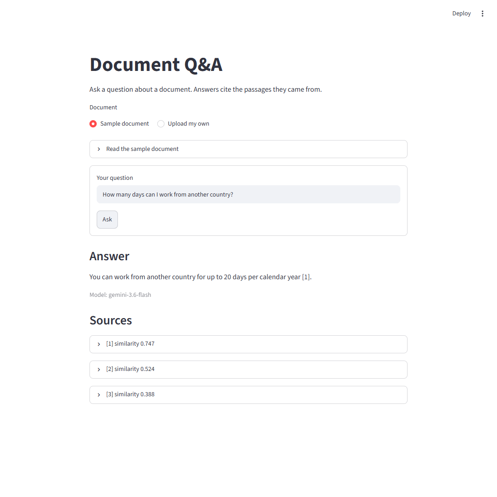

# rag-doc-qa

Ask questions about a PDF or text document and get answers that cite the passages they came from.

**[Try the live demo](https://rag-doc-app-8jwjzkvu9jgy5h8esrkr2e.streamlit.app/)**. It may take a moment to wake up, and it can stop answering for the day when its free API quota runs out. Do not upload private documents.

## Problem

Finding one fact in a long document is slow, and a general-purpose LLM does not know what your document says. Asked anyway, it may invent an answer.

## Solution

This project uses retrieval-augmented generation (RAG):

1. **Load** the text from a PDF or text file (`pypdf`).
2. **Chunk** it into overlapping pieces (LangChain `RecursiveCharacterTextSplitter`).
3. **Embed** each chunk locally (`sentence-transformers`, multilingual MiniLM).
4. **Search** an in-memory vector store for the chunks closest to the question (Chroma, cosine similarity).
5. **Generate** an answer from those chunks only, with citations (Gemini through LangChain).

If a model is unavailable or out of quota, the app tries the next of three Gemini models. The output shows which model answered.

## How to run

Requires Python 3.14 (the version tested) and a [Gemini API key](https://aistudio.google.com/apikey).

```powershell
python -m venv .venv
.venv\Scripts\Activate.ps1
pip install -r requirements.txt
Copy-Item .env.example .env   # then put your key in .env
streamlit run app.py
```

The app opens at http://localhost:8501. The embedding model downloads on the first run.

To use the command line instead of the web interface:

```powershell
python ask.py samples\remote_work_policy.txt "How much is the home office allowance?"
```

On Gemini's free tier, Google may use submitted content to improve its products, and the app sends the retrieved chunks and your question. Do not use the free tier with private documents.

## Example output



From the command line:

```text
> python ask.py samples\remote_work_policy.txt "Yurt dışından kaç gün çalışabilirim?"
Çalışanlar, her takvim yılı için en fazla 20 gün başka bir ülkeden (yurt dışından) çalışabilirler [1].

Model: gemini-3.6-flash
Sources:
[1] similarity=0.795 Working abroad. Employees may work from another country for up to 20 days per ca...
```

The sources list is shortened here. A question the document cannot answer, such as "What is the capital of France?", returns "The document does not contain this information."

## Limitations

- Scanned PDFs are not supported, because there is no OCR step.
- The index lives in memory, so it is rebuilt whenever the app restarts.
- Each question is answered on its own, with no chat history.
- The web app allows 10 questions per session, 50 per day, and documents up to 1,000 chunks, because the public demo spends one shared API quota. The counters live in memory, so they reset when the session or the app restarts.
- Gemini's free tier has its own daily limits, as low as 20 requests per model at the time of writing. When all three models reach theirs, the app cannot answer until the quota resets.
- Answer quality has been checked on only three sample questions, not measured with an evaluation set.
- The sample document is fictional.
